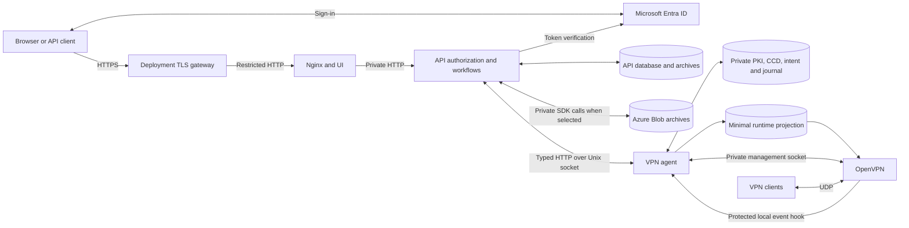

# Architecture

Rivet separates business authorization from privileged VPN operations.
This guide describes the components, their trust boundaries, and the
application backends that connect them. The detailed command and agent
reference is in [VPN control](vpn-control.md).

- [Components and boundaries](#components-and-boundaries)
- [Application backends](#application-backends)

## Components and boundaries

The API, agent, OpenVPN daemon, and Nginx/UI are separate processes in native
and container deployments. The reference runs one API instance and one active
VPN writer on a dedicated Linux host.

### Components and ownership

| Component | Owns | Does not receive |
| --- | --- | --- |
| API | Users, devices, grants, client ownership, address pool, desired state, workflow records, shared profile, credential delivery | CA directory, management socket, `NET_ADMIN`, container-runtime socket |
| Agent | Authoritative VPN configuration, PKI, CCD, owned routes/rules, mutation journal, event spool | Entra tokens, business roles, API database, Blob credentials |
| OpenVPN | Live tunnel and sessions, runtime pool writes | CA private key, CA database, client private keys, API state |
| Nginx/UI | Static UI and same-origin `/api` proxy | VPN state, agent sockets, private credentials |
| Deployment operator | Service lifecycle, host policy, secrets, builds, consistent backup/restore | No general-purpose privileged API is exposed for these actions |

The API database is the business source of truth; the agent owns actual VPN
state. They never write each other's database or PKI. SQLite is the
single-instance reference. MySQL/PostgreSQL extras exist, but choosing another
database does not establish multi-replica or high-availability support.

`sciaiot-rivet[api]` and `sciaiot-rivet-agent` install the same core version
in separate environments. The agent metapackage does not pull API extras or
duplicate the implementation. See [native installation](deployment.md#native-installation).

### Authentication and application authorization

Generic HTTP middleware extracts a bearer token and invokes the authentication
service on a worker thread. The selected `IdentityProvider` verifies the token
and returns an immutable `VerifiedIdentity`: issuer, subject, canonical role,
human/service kind, and bounded display name. Raw tokens and provider claim
dictionaries do not enter application request state.

The Entra adapter owns RS256 verification, trusted signing-key retrieval,
issuer/audience/time checks, external role mapping, and delegated versus
app-only claim rules. Application authorization maps canonical roles to Rivet
permissions and enforces ownership and grants. The adapter cannot supply
permissions. Existing identities retain their `(issuer, subject)` keys.

Authentication and storage are independent startup selections. Entra is the
only implemented identity provider; unsupported selections fail explicitly.
All launch paths validate authentication configuration, and application
lifespan owns provider construction and cleanup. Provider and registration
changes require a restart; they do not migrate identities or grants.

Browser gates, account controls, and the API client use a shared authentication
context. Its Entra adapter encapsulates MSAL, active-account selection, silent
token acquisition, redirect coordination, and sign-out. `/me` remains the
authority for application roles and permissions. See
[configuration](configuration.md) for settings and rollout compatibility.

### Deployment and privilege boundaries

Native installation runs an unprivileged API, a distinct agent, OpenVPN, and
Nginx under systemd. Compose uses host networking for OpenVPN and the agent;
API and Nginx share a private bridge. Only Nginx publishes HTTP; OpenVPN binds
its configured UDP endpoint. HTTPS ingress and VPN UDP ingress are separate.

The container reference uses rootful Docker, no user-namespace remapping,
AppArmor `docker-default`, the default seccomp policy, and `iptables-nft`.
Services use read-only roots, bounded writable tmpfs, resource/log limits,
dropped default capabilities, and `no-new-privileges`. API and web have no
capabilities. OpenVPN receives `NET_ADMIN`, `SETUID`, `SETGID`, and
`/dev/net/tun`. The agent bootstrap drops from root to its own identity with
only effective/ambient `NET_ADMIN` before application code runs; it has no
TUN device. Exact IDs and mount modes are in
[container deployment](deployment.md#state-and-identity-contract).

Host networking and `NET_ADMIN` remain powerful: a compromised agent can
affect host networking. Verify effective capabilities, peer IDs, and mount
isolation on the actual engine. Do not use `privileged` or broader capabilities
to bypass a failed check. Health checks gate startup but do not prove external
connectivity or continuous dependency recovery.

### Control and event boundaries

The API uses the typed `VpnControl` port. Production native and container entry
points require the `agent` backend. `host` and `shadow` remain compatibility
and development adapters; their lower-level default is not the deployment
recommendation. See [backends](#application-backends).

Protocol 1.0 uses bounded HTTP/JSON over `/run/ovpn-agent/agent.sock`, with
filesystem permissions and Linux `SO_PEERCRED` checks in both directions.
There is no TCP fallback. Commands carry typed domain intent, never arbitrary
paths, shell text, executable names, environment, or caller-supplied roles.
The API authorizes first; the agent independently validates actual state and
ownership. Compromising the API still permits requests within this vocabulary.

Credential archives are the intentional exception to the private-key boundary:
the agent sends a bounded active-client ZIP through a framed stream. The API
checks client/generation, byte count, and digest before publication to an
authorized caller. Partial bytes and credentials must not enter JSON control
messages or logs. The shared profile is credential-free and API-owned.

OpenVPN emits connection events through a protected local hook socket. The
hook verifies agent identity, bounds delivery time, and records loss when
delivery fails. VPN traffic does not wait for the API. API receipts, history,
and cursor are committed before acknowledgment; gaps trigger session
reconciliation. Loopback HTTP hooks are confined to host/shadow compatibility.

[The protocol](vpn-control.md#control-protocol) defines framing, bounds, and failures;
[the route matrix](vpn-control.md#api-route-mapping) defines public authorization.

### Mutations and network policy

The agent is observation-only until mutation families are explicitly enabled.
Accepted writes have immutable operation IDs, expected generations, durable
intent, and per-effect evidence. Uncertain work fences later writes. Retry
queries the original ID; a new ID must not bypass an unknown result. A
committed revocation cannot be undone by database rollback or an old backup.

The agent maintains exact owned routes, marked CCD blocks, and the
`OVPNCP_FORWARD` chain with first-position TUN ingress/egress anchors. Owned
allow rules require both TUN selectors. Foreign rules are preserved; grants
are refused when their compatibility cannot be proven. Host forwarding, NAT,
cloud rules, and service restarts are operator-owned. Docker bridge creation
can change FORWARD ordering; verify the baseline after network creation and
before admitting VPN clients.

OpenVPN reads only the agent's minimal runtime projection: approved config,
CA/server certificates, server key, CRL, required transport material, and CCD.
Atomic CRL/CCD replacement needs a directory mount, not an individual-file
bind mount. The separate daemon-owned pool is agent-readable.

The mutation reference supports OpenVPN 2.6, numbered IPv4 TUN, topology
subnet, disabled DCO, and the reviewed Easy-RSA lifecycle. Unsupported
directives and ownership conflicts fail closed. See [agent operation](vpn-control.md#agent-operation).

### Persistent identifiers

Storage and network ownership identifiers are stable contracts. Preserve them
when installing, upgrading, or restoring Rivet:

- `ovpncp.db` and its SQLite sidecars;
- encrypted migration/recovery format magic and schema versions;
- `.ovpncp-migration.json`, `.ovpncp-journal-identity`, and
  `ovpncp-deleted.json`;
- `OVPNCP_FORWARD`, `ovpncp:` firewall comments, and managed CCD blocks;
- the Azure Blob Storage container `ovpncp`.

Service accounts (`ovpn-api`, `ovpn-agent`, `ovpn-openvpn`), groups, socket
paths, and `/var/lib/ovpn-agent` define permission and ownership boundaries.
Do not rename them for branding; use the selected deployment's identity and
path contract.

### Persistent state and recovery

Persistent state includes the API database/profile/archives, complete PKI,
CCD/configuration, agent journal and identity anchors, network ownership,
and pool state. Sockets/PIDs/status are runtime data; event-loss markers must
remain until processed. Never discard journals or CA history to clear errors.

Secrets remain outside images and browser configuration. The API container
supports reviewed secret files; native services use protected environment
files or deployment-owned credential delivery. Registry publish/pull identities
are separate from application identities. See [configuration](configuration.md).

The migration bundle contains VPN state only. Whole-application recovery
coordinates it with API/agent state and separately protected deployment
settings and credentials. [Recovery](data-management.md#backup-and-recovery) defines the procedure;
no backup scheduler is supplied.

Live Entra sign-in, external UDP, reboot behavior, off-host recovery, capacity,
and release evidence require verification in the selected deployment. The
[release checklist](builds.md#release-verification) tracks those requirements.

## Application backends

The API selects one typed `VpnControl` implementation. Native and container
release entry points require `agent`. The lower-level source default remains
`host` for compatibility; it is not an instruction to run a new root API.
`shadow` compares selected observations while keeping all effects host-owned.
See [agent operation](vpn-control.md#agent-operation) for production agent configuration.

### Configuration

| Setting | Default | Meaning |
| --- | --- | --- |
| `RIVET_VPN_BACKEND` | `host` | Exactly `host`, `shadow` or `agent`; invalid or empty values fail startup. |
| `RIVET_AGENT_SOCKET` | `/run/ovpn-agent/agent.sock` | Canonical absolute ASCII filesystem socket path, at most 107 bytes; traversal, control characters and URLs are rejected. |
| `RIVET_AGENT_UID` | unset | Numeric trusted agent UID; required with `agent` or `shadow`. The client checks Linux `SO_PEERCRED` before transmitting any request bytes. |

No TCP fallback, redirects, token forwarding, privilege escalation or automatic
mutation replay is supported. Configured settings are validated at startup;
restart the API to change its backend. Agent mode also removes the legacy
loopback connection-hook authentication exception and skips installing host
hook scripts. Agent daemon events use a protected local producer and durable
UDS polling, never an anonymous callback to the business API. Shadow mode retains the host hooks and loopback
exception because all legacy VPN behavior remains host-owned.

The API uses a synchronous typed port. Blocking workflow handlers run in the
ASGI worker pool, leaving the event loop available during agent outages. The
wire client negotiates exact protocol 1.0, applies one total deadline of at
most 60 seconds (including handshake), accepts fixed-length bounded HTTP
bodies, and checks correlated responses. Framed archive replies use
`application/octet-stream`; their inner manifest retains `application/zip`.
Unconsumed archives own and release their connection and one of four slots.

### Compatibility and ownership

All 48 public method/path pairs, schemas, permissions, HTTP statuses and
RFC 7807 responses remain unchanged. Shared profiles remain API-owned;
remote hosts still come from explicit administrator input. Agent server views
use `agent-managed` for private path fields and null optional hook paths.
Absent optional profile settings remain absent from generated profiles; their
required legacy server-view string fields use empty strings. The observed
interface and server address are retained exactly. The server address is
excluded from allocation even when it is not the subnet's first host.
Agent-mode pool initialization rejects networks larger than 65,536 addresses
before enumeration. Complete discovery and route snapshots are capped at
10,000 records and 60 seconds; repeated cursors and generation drift fail
before import changes are committed.

`HostVpnControl` retains a narrow local compatibility interface for raw server
configuration, service status/time/period, route lines, discovery skip counts,
legacy certificate metadata/cache packaging, and staged deletion rollback.
These values never cross the wire. Main lifecycle, address, access/push and
route mutations use typed `execute` calls in every backend. The host port also
provides bounded `open_archive`; existing host cache packaging retains its
historical helper behavior and archive layout. Unsupported host management
socket/event/actual-state snapshot operations return `unavailable`, rather
than fabricating agent observations.

The legacy host's command sequence is not crash atomic. Its process-local
replay ledger reports uncertain effects as `unknown`, retains IDs, and refuses
new admissions after 10,000 retained results/tombstones. Restart loses that
ledger; shared conformance explicitly retains fixture state and is not proof
of host crash recovery. Selecting `host` remains the transition rollback. Freeze control writes and
reconcile every pending agent workflow first; retain all operation tables and
verify that the legacy host configuration and permissions are still usable.
Changing the backend flag must never bypass uncertain remote effects.
Never use a restart or a new operation ID to resolve an uncertain agent write.

### Durable remote workflows and archives

API-owned tables store workflow intent, exact per-step requests and
observed responses, and pending local archive cleanup. They are created by
the existing table initialization; existing business tables are unchanged.
Back up these tables with the application database. They contain desired
network metadata, not credentials, and must not appear in logs.

Before dispatch, the API commits immutable desired intent and the original
operation ID/generation in an independent journal transaction. A unique active
resource fence rejects a changed request while an earlier intent is unresolved;
a unique workflow/step position prevents concurrent duplicate dispatch IDs.
Business completion claims the workflow once, atomically in the business
transaction. A failed business commit leaves original intent available.

Retrying the exact authorized request queries an uncertain step by its
original operation ID, including pending, partial or unknown responses.
Fingerprint, client and generation are rechecked against the stored request.
Only a successful result advances the workflow. On a genuine `not_found`,
an explicit API retry may resubmit only the exact original ID, command and
generation to the durable agent. Expired IDs and uncertain evidence never
authorize a new ID or changed intent. Proven terminal pre-effect failures are
retained in `VpnStepAttempt` before an explicit retry allocates a new attempt. A pending route deletion can be
reconciled even if the route has already disappeared; an ordinary missing
route retains its existing 404 response. Restricted-network ownership links
to its exact creation workflow, preserving separate access/push intent IDs.
Opt-in `RIVET_VPN_RECONCILE=1` performs bounded background lookups; it does not
dispatch missing operations with its short lookup budget. The agent independently
reconciles accepted intents. `RIVET_VPN_EVENTS=1` commits durable event receipts,
history and cursor before immutable acknowledgements. Both flags default off
and require agent mode. Inconclusive PKI/reload outcomes remain fenced for
operator recovery; no automatic guess or CA rollback is permitted.

The API selects one `ArchiveStore` at startup: local files or the existing
private Azure Blob container. The certificate service validates and packages
archives, publishes bounded local staging atomically, and uploads Blob bytes
when selected. Host downloads read from the selected store. Agent-backed
downloads always obtain fresh active-generation metadata, consume and verify
a bounded archive, then recheck generation before returning the public ZIP.
Partial or cached cloud bytes never replace this verification. Stored archives
are deleted only after the client database commit; failed post-commit cleanup
keeps a truthful `204` and requires manual orphan removal. Neither archive
bytes nor SAS URLs or storage credentials cross JSON control messages.

### Verification boundary

The deterministic in-process fake supports the complete command vocabulary,
finite state, exact-ID replay, ownership checks, bounded pages and archive
cancellation. It is injected directly in application tests; `fake` is not a
production environment setting. Shared core, validation, failure and archive
conformance runs against it, the host adapter with mocked privileged helpers,
and the agent client talking to a synthetic test-only Unix-socket peer.
These tests never touch host firewall/routes, live PKI, VPN services or Azure.
Live VPN, mutation, and Compose checks use the separately invoked
[integration harnesses](../tests/integration/README-container.md). Their
isolation and evidence limits are explicit. New artifacts and deployment
environments require their own [release checks](builds.md#release-verification).

### Shadow comparison

On an explicitly prepared compatibility deployment, shadow mode keeps legacy
responses and mutation paths while comparing reads with a separate agent.
Each comparison has a 500 ms budget and reports only command kind plus
`match`, `mismatch`, or `unavailable`. It logs no values or identities. Agent
failure leaves the host result intact and delays further comparisons for five
seconds. It does not send management writes or make legacy effects crash-safe.
