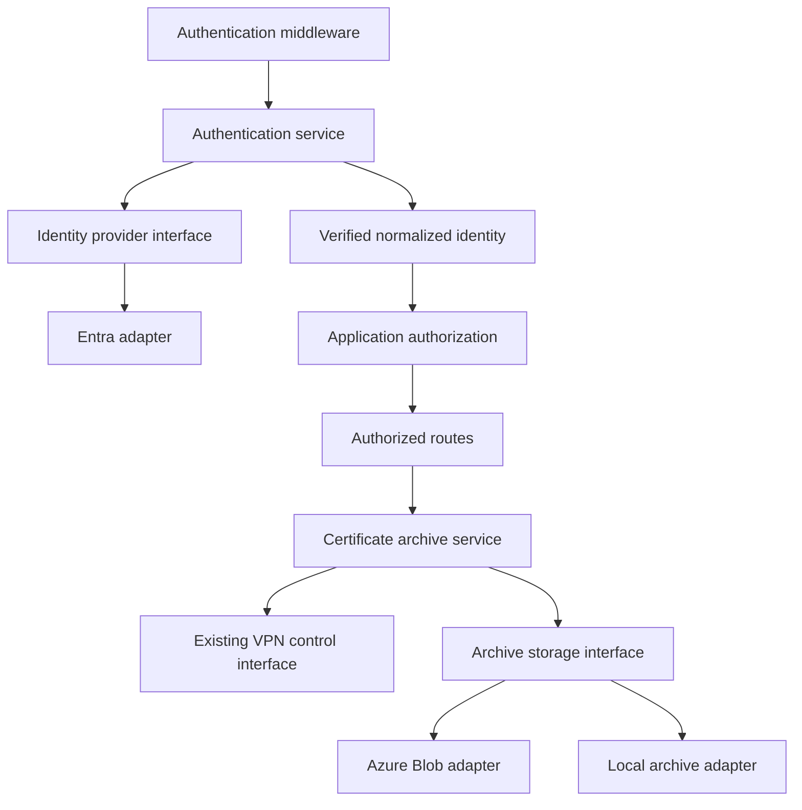

# Provider-independent storage and authentication plan

Status: storage, authentication, and browser implementation complete.
Live Azure and deployed-browser smoke verification remains outstanding.

Introduce application services and typed provider interfaces, then adapt the
existing Azure implementations. Prepare Rivet for Amazon S3 or local MinIO
storage and Amazon Cognito or Keycloak authentication. Implement only Azure
adapters and the existing local archive behavior in this phase.

Storage and authentication are independent deployment choices, selected at
startup. Runtime switching, simultaneous identity providers, data migration,
and implementation of the additional providers are deferred.

## Existing coupling

| Area | Current implementation | Planned boundary |
| --- | --- | --- |
| Storage | `middlewares/azure_storage.py` creates Blob clients at import time and intercepts URL suffixes | Archive service calls a storage interface explicitly |
| Downloads | `services/certificates.py` and client/identity routes use an Azure request-state flag and placeholder responses | Archive service selects the permitted source |
| Authentication | `middlewares/azure_security.py` combines HTTP handling, settings, keys, and token validation | Generic middleware calls an authentication service |
| Authorization | `authorization.py` reads Entra settings and interprets `oid`, `scp`, and `roles` | Adapter normalizes identity; application policy grants permissions |
| Registration | `/me` reads Azure auto-registration settings | Provider-independent registration policy |
| Startup | Native/container entry points validate Entra directly | Shared provider settings and factories |
| Browser | Authentication components and API client depend directly on MSAL | Browser authentication context with an Entra adapter |

Follow the existing VPN architecture: contracts under `application/`, concrete
implementations under `adapters/`, and orchestration under `services/`.

## Proposed architecture



Proposed modules, relative to `src/sciaiot/rivet/`:

- `application/storage/`: storage protocol and safe error types.
- `application/authentication/`: identity protocol, normalized identity,
  canonical roles, and safe error types.
- `adapters/storage/azure_blob.py` and `local.py`: storage implementations.
- `adapters/authentication/entra.py`: Entra verification and claim mapping.
- `services/authentication.py`: provider invocation and identity handoff.
- `services/certificates.py`: extend the existing archive service.
- `services/provider_settings.py`: validated selection and registration policy.
- `middlewares/authentication.py`: bearer extraction and HTTP error handling.
- `dependencies.py` and application lifespan: construct, inject, and close
  adapters through explicit factories.

Keep Python, FastAPI, SQLModel, `python-jose`, and existing Azure dependencies.
Use standard-library protocols/dataclasses. Add no provider SDK, general plugin
framework, VPN protocol, database backend, or deployment platform in this phase.
Interfaces must not expose Azure SDK objects, provider URLs, raw tokens, or
arbitrary claim dictionaries. Tests inject fakes without network access.

## Storage service and adapters

Define a synchronous `ArchiveStore` protocol:

| Operation | Contract |
| --- | --- |
| `put(client_name, content) -> None` | Replace the client's packaged archive |
| `get(client_name) -> bytes` | Return archive bytes or a typed failure |
| `delete(client_name) -> None` | Remove the archive; absence is success |

Validate client names at the boundary and derive `<client_name>.zip` inside
adapters. Callers cannot supply paths, containers, buckets, or URLs. Bound
reads/writes using the archive limits established for agent transfers. The
byte-oriented contract matches current downloads; streaming can be added
later while preserving verification before publication and resource cleanup.

The local adapter retains the configured certificate directory with safe path
handling and atomic replacement. It represents local files, not MinIO. The
Blob adapter retains container `ovpncp`, overwrite behavior, and private SDK
reads. Do not expose signed URLs or credentials through the interface.

Extend `CertificateArchiveService` to own these workflow decisions:

1. Authorize and validate clients before any archive or storage operation.
2. Package through existing VPN logic. Preserve local staging and generation
   checks, then upload when Blob is selected. Avoid writing twice when local
   staging already published the same archive.
3. For host downloads, read from the selected store. For agent downloads,
   always obtain fresh verified agent bytes and recheck active generation,
   regardless of storage selection. Preserve the existing verified path for
   shadow mode. Cached cloud bytes must never replace this verification.
4. Preserve ZIP attachments, `Cache-Control: no-store`, empty package `204`
   responses, and existing safe RFC 7807 certificate failures.
5. Delete stored archives only after durable client deletion. Preserve SQL
   rollback and staged-file cleanup ordering. A post-commit storage cleanup
   failure keeps the truthful `204` and logs redacted manual cleanup guidance.
   Storage and SQL do not share an atomic transaction.

Rewire administrative and self-service flows explicitly. Remove storage URL
interception, Azure request-state flags, and placeholder download responses.
Keep SDK/file operations off the async event loop through existing threaded
routes or threadpool helpers. Normalize SDK exceptions to safe application
errors and preserve current public certificate failure status/details. Never
silently fall back to local bytes after a selected cloud provider fails.

## Authentication service and authorization

Define `IdentityProvider.authenticate(token) -> VerifiedIdentity`. The immutable
result contains issuer, subject, canonical role, identity kind (`human` or
`service`), and bounded display name. It contains only verified information.

The Entra adapter owns signature, issuer, audience, and time validation; trusted
key retrieval; external role mapping; and current Entra delegated/app-only
checks. Preserve the exact single-recognized-role rule and existing
`oid`/`sub`/`scp` distinctions during extraction. Future providers implement
identity-kind checks using their own verified semantics.

The authentication service invokes the selected provider. Generic middleware
extracts bearer tokens and stores normalized identity in request state.
`authorization.py` constructs the existing application principal and applies
Rivet permissions, ownership, and grants. Providers cannot supply arbitrary
permissions. Preserve `device_user`, `sysadmin`, and `service_admin` behavior,
including restrictions on service identities in human registration/self-service.

Keep `(issuer, subject)` as the durable identity key. Retain Azure fallback
display names for existing behavior. A future identity-provider switch produces
different identities: do not merge accounts by email/display name or transfer
grants automatically. Account migration is separate work.

Generic middleware retains exact documentation and local OpenVPN hook
exceptions, root-path handling, and backend restrictions. Add no authentication
bypass or production anonymous mode. Preserve `401` authentication failures,
`403` access denials, and safe server failures for configuration/provider errors.

Bound trusted key-fetch timeouts and response sizes, avoid blocking the event
loop, and keep explicit algorithm allowlists. Never use token-supplied URLs to
retrieve keys. If adding key caching, bound lifetime and unknown-key refresh
attempts and test rotation/outages. Keep the existing JWT library.

## Configuration and lifecycle

| Proposed setting | Initial behavior |
| --- | --- |
| `RIVET_STORAGE_PROVIDER` | `local` or `azure_blob`; absent means infer Blob from a configured legacy connection string, otherwise local |
| `RIVET_AUTH_PROVIDER` | `entra`; absent means Entra with mandatory valid settings |
| `RIVET_AUTH_AUTO_REGISTER_USERS` | Strict boolean; fall back to `AZURE_ENTRAID_AUTO_REGISTER_USERS`, then the current `true` default |

Retain `AZURE_STORAGE_CONNECTION_STRING`, credential-file support, and existing
`AZURE_ENTRAID_*` values as adapter configuration. Conflicting old/new
registration values fail validation. Explicit storage selection wins over
legacy inference; credentials for unselected adapters are never used. Reject
blank, unknown, and not-yet-implemented provider selections. Configured Blob
with missing credentials or SDK dependencies prevents startup.

Use shared validation for direct ASGI, native, and container startup while
retaining their privilege, agent, and network checks. Construct providers once
per application lifecycle and close resources on shutdown. Remove import-time
clients and optional-authentication import handling: missing dependencies must
never silently disable authentication.

## Browser and deployment

Introduce a browser authentication context exposing readiness, signed-in state,
sign-in, sign-out, and API access-token acquisition. Keep MSAL as the only
production implementation. Move MSAL instances, hooks, redirect coordination,
and refresh behind the Entra adapter. Gates, controls, and the API client
consume the context; `/me` stays authoritative for application access.

Add a provider discriminator to public runtime configuration and accept the
existing three-field Entra payload during rollout. Keep validation within the
selected adapter. Preserve runtime-config precedence, token-cache behavior,
redirect-loop protection, and production rejection of development/E2E auth
modes. Browser configuration contains public values only.

Update native/container renderers, startup checks, Compose validation,
environment examples, frontend build guards, and deployment tests together.
Existing Azure configuration, archive keys, and identity records remain valid;
this phase requires no database migration. A provider switch requires restart,
not a build containing embedded credentials.

## Implementation sequence

Storage, authentication, and browser portions are implemented. Behavior
changes are covered by focused and full regression suites. Live Azure smoke
verification is tracked separately below.

- [x] Storage characterization, typed contracts, local/Blob adapters, provider
  settings, lifecycle, certificate route wiring, deletion ordering, and storage
  documentation.
- [x] Authentication characterization, typed identity contracts, Entra adapter,
  registration policy, and generic middleware.
- [x] Browser authentication context and deployment integration for identity.

- [x] 1. Characterize Azure/local behavior across both route families, VPN
  backends, package failures, deletion ordering, Entra roles, `/me`, startup,
  and browser token handling.
- [x] 2. Add typed contracts, normalized identity, safe errors, fake adapters,
  settings, and factories. Test defaults, selection, aliases, invalid values,
  missing optional SDKs, and lifecycle cleanup.
- [x] 3. Extract local/Blob adapters and inject storage into the archive service.
  Rewire package/download/delete flows, then remove Azure storage middleware.
- [x] 4. Extract the Entra adapter and authentication service/middleware. Remove
  Entra imports from authorization and identity routes; centralize validation.
- [x] 5. Isolate MSAL behind browser context; update public configuration and
  deployment integration while retaining existing Azure setup.
- [x] 6. Update architecture, configuration, deployment, user, and frontend docs;
  run quality gates and record results and outstanding manual verification.

## Verification and completion criteria

Extend or move coverage in `test_azure_storage.py`, `test_security.py`,
`test_authorization.py`, `test_identity_api.py`, `test_client_deletion.py`,
certificate/backend tests, native/container startup tests, and frontend
authentication/API-client tests. Share storage contract tests across local,
fake, and mocked Blob adapters. Test Entra claim mapping independently from
provider-independent authorization policy.

Required cases include denied access making no storage calls; unsafe names
and paths; missing/oversized archives; upload failures; post-commit cleanup
failures; stale/revoked agent archives; malformed/expired/wrong-issuer or
audience tokens; wrong identity kinds; conflicting roles; key-fetch failures;
registration disabled; unchanged identity/grants; and exact hook bypasses.
Assert errors and logs exclude credentials, tokens, signed URLs, private paths,
IP addresses, and certificate bytes.

Run from the repository root during implementation:

```bash
ruff format --check .
ruff check .
mypy .
pytest --cov=src/sciaiot/rivet --cov-report=term-missing
```

For browser changes, run from `frontend/`:

```bash
CI=true npm run lint
CI=true npm run typecheck
CI=true npm test
CI=true npm run build:runtime
CI=true npm run test:production
CI=true npm run test:e2e:production-guard
CI=true npm run api:check
```

Target more than 80% coverage for changed application code. Ordinary tests
mock Azure and privileged operations. Record live Azure sign-in, service-token,
Blob, and deployed-browser smoke verification separately; unit tests alone do
not establish live compatibility.

Storage implementation verification (2026-10-14): `ruff format --check .`,
`ruff check .`, `mypy .`, and the full `pytest --cov=src/sciaiot/rivet
--cov-report=term-missing` suite passed. Storage adapters and the certificate
service exceed 80% statement coverage. Live Blob behavior has not been
verified against an Azure account; the tests use SDK mocks.


Authentication implementation verification (2026-10-15):

- Added the immutable identity contract, Entra adapter, authentication service,
  generic middleware, application-owned permissions, and startup-pinned
  registration policy. Shared validation covers ASGI, native, and container
  startup; unsupported providers and conflicting registration aliases fail.
- Entra verification uses RS256, the configured issuer/audience, required
  expiration, bounded trusted key retrieval, and existing exact role and
  delegated/app-only rules. Real signed-token tests use generated local keys.
- Browser gates, controls, and API requests use the authentication context;
  the Entra adapter owns MSAL. Runtime configuration accepts the legacy
  three-field payload and the new explicit `entra` discriminator.
- `ruff format --check .`, `ruff check .`, and `mypy .` passed.
- `pytest --cov=src/sciaiot/rivet --cov-report=term-missing` passed:
  1,159 tests, 90% overall coverage. Entra adapter coverage is 94%; generic
  middleware and provider settings are 98%; the authentication contract,
  service, and application lifespan are 100%.
- Frontend `CI=true npm run lint`, `CI=true npm run typecheck`,
  `CI=true npm test` (193 tests), `CI=true npm run build:runtime`,
  `CI=true npm run test:production` (9 tests),
  `CI=true npm run test:e2e:production-guard`, and
  `CI=true npm run api:check` passed. The existing large-chunk build warning
  remains; the generated API schema is unchanged.
- Azure services and privileged operations were mocked. Live Entra human
  sign-in, service-token validation, and deployed-browser smoke checks have
  not been run. Live Blob verification also remains outstanding from storage.

Completion requires provider-independent application routes/services/policy,
covered Azure/local behavior, fail-closed startup, and browser consumers that
no longer depend on MSAL. Fakes must exercise application flows without Azure
calls. Unsupported providers must fail explicitly rather than appear available.

## Deferred provider work

- **Amazon S3 and local MinIO:** implement an S3-compatible adapter and verify
  each target independently against the storage contract. Endpoint, credentials,
  TLS, addressing, region, and error handling belong to adapter settings/tests.
  Local MinIO remains a network storage service.
- **Amazon Cognito and Keycloak:** implement identity adapters and browser
  login/configuration. Verify each provider's access-token and service-identity
  rules and map them to Rivet roles. Reuse token utilities only when semantics
  match; do not copy Entra claim assumptions.
- **Deployment migration:** plan archive copying/verification and explicit
  account/grant migration separately. Selecting a provider does not migrate
  archives or identities. Preserve prior data/configuration until a separately
  reviewed cutover and rollback have completed.

Before implementing later adapters, verify current official provider
documentation and document dependency changes. This plan does not claim
compatibility with providers that have not been implemented.
