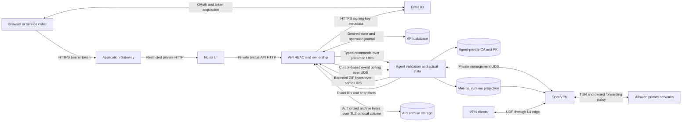

# Container architecture decisions and threat model

Status: Phase 0 complete; independent engineering/security review accepted.
Date: 2026-09-14 Scope: [upgrade plan](container-architecture-upgrade-plan.md),
Phase 0 only.

These are concrete engineering defaults for implementation and reference
acceptance, not measured production SLAs or operator/business approval. The
plan's non-goals remain accepted as the proposed scope: one active VPN, no new
VPN/identity/cloud provider or PKI implementation, no public agent, no API
container-runtime socket or privileges, no backend/UI migration through M0, and
no automatic Azure changes. Production sizing, actual addresses, Azure resources
and cutover remain later operator-controlled gates.

## Decisions

| ID | Decision and consequence |
| --- | --- |
| D1 | Docker Compose on one dedicated Linux VM initially; OpenVPN and agent use host networking, API and Nginx use a private bridge. No unrelated workloads. API has no published port; only private Nginx HTTP and OpenVPN UDP are ingress. One VPN writer, one API replica. Kubernetes and HA remain deferred. |
| D2 | SQLite on an encrypted local API volume for the single-instance reference. Use transactional PostgreSQL before a second API replica; existing MySQL remains compatible but is not the reference. Database credentials and migrations belong to API/deployment, never agent. |
| D3 | Explicit `iptables-nft` compatibility backend, version-pinned with the image/host compatibility record. No automatic legacy/nft backend switching or raw nftables API. Agent renders typed IPv4 intent into a dedicated `OVPNCP_FORWARD` chain with stable rule IDs/comments and two owned FORWARD anchors matching configured TUN ingress and egress. Host administrators retain base policy, NAT, cloud/host forwarding and other chains. Backend mismatch fails readiness. |
| D4 | API database owns users, grants, client ownership, desired VPN state and operation records. Agent owns actual VPN config, PKI, CCD, managed network intent realization, operation journal and event spool. OpenVPN owns live sessions/TUN and runtime pool writes. No shared database writer or shared PKI writer. |
| D5 | Versioned HTTP/JSON on `/run/ovpn-agent/agent.sock`; filesystem permissions plus peer-identity checking. No TCP listener. Separate OpenVPN management UDS. No shell, argv, arbitrary path, executable or environment input in the protocol. |
| D6 | Shared profile remains API-owned in a dedicated profile volume. Agent returns only typed sanitized transport/server fields; no PKI or config mount reaches API. Preserve exact download contract below. This refines the plan's optional agent-owned generated-profile responsibility. |
| D7 | First-party OpenVPN, agent, API and Nginx/UI images in a private Azure Container Registry. CI publisher and deployment pull identities are separate; application containers receive no registry credentials. Immutable digests, SBOM/provenance, signatures and vulnerability gate are Phase 5 deliverables; no registry is created here. |
| D8 | Operator delivers secrets through per-service read-only files under `/run/secrets`, backed by protected encrypted host storage. Compose grants each service only its files. Existing environment-based adapters need file-loading support before this target is deployed. No secrets in Compose YAML, images, build arguments, frontend variables, logs or command lines. |
| D9 | Encrypted, coordinated recovery sets with 15-minute checkpoints, daily full backups, 35-day retention and a separate off-host encrypted copy. Backup encryption keys travel through a separate operator secret channel. Restore drills quarterly and before cutover; details below. |

Host networking removes network-namespace isolation for the VPN containers;
published-port mappings do not constrain them. This is accepted only on the
dedicated VM, with no public agent listener and restricted host ingress. [Docker
host networking](https://docs.docker.com/engine/network/drivers/host/). Compose
secret grants provide mounted files, so protection of their host source is part
of D8. [Compose secrets](https://docs.docker.com/compose/how-tos/use-secrets/).

## Identities, capabilities and mounts

These logical identity names are fixed; deployment resolves non-colliding
numeric IDs locally. No source numeric UID/GID is imported from M0. Every
container drops all capabilities first, uses a read-only root filesystem,
`no-new-privileges`, bounded tmpfs, seccomp and an AppArmor/SELinux policy. No
host PID namespace, device wildcard, Docker/containerd socket, host service
manager socket, SYS_ADMIN, SYS_MODULE, DAC_OVERRIDE or full privileged mode.

| Process | Identity and capabilities | Allowed mounts and permissions |
| --- | --- | --- |
| Nginx/UI | `ovpn-web`, no capabilities; listen internally on 8080 | Image-owned static files/config RO; private bounded cache/tmpfs only. No API data, sockets or secrets. Deployment maps private host HTTP backend port to 8080. |
| API | `ovpn-api`, no capabilities; supplementary `ovpn-control` group | `api-data`, `api-profile`, optional local `api-archives` RW, owned by API, dirs 0700/files 0600. Agent socket directory RO, socket accessible by group. Its DB/storage secret files RO mode 0400. No VPN runtime/state mounts. |
| Agent | `ovpn-agent`, NET_ADMIN for network operations; primary `ovpn-runtime` GID; supplementary `ovpn-control` group | Private authoritative `vpn-config`, `vpn-pki`, `vpn-ccd`, journal/event spool RW, dirs 0700/files 0600; runtime projection RW. Control socket directory owner agent/group control mode 02750, explicitly created socket 0660. Management socket directory RO with group access to socket. No `/dev/net/tun`, DB, archive-storage secret or API data mount. |
| OpenVPN | Starts UID 0, primary `ovpn-runtime` GID, with NET_ADMIN, SETUID, SETGID only; `user ovpn-openvpn` and `group ovpn-runtime` then drop privileges | `/dev/net/tun` only device. Minimal `vpn-runtime-projection` RO; private management/status/PID tmpfs and pool-state volume RW. No authoritative PKI/config/CCD mount. |
| Deployment/backup operator | Host administrative identity, outside application containers | Initializes named volume ownership, delivers secrets, pulls images, controls service lifecycle, freezes writers and captures/restores recovery sets. No generic operator endpoint exposed by API/agent. |

The API socket directory is mounted read-only to prevent socket replacement;
connecting still requires Unix socket write permission. Agent checks the peer
UID against the configured API identity, not merely membership in a shared host
group. Only agent can create its socket. Deployment precreates its
`ovpn-agent:ovpn-control` directory mode 02750; setgid inheritance gives the
agent-created socket the control group, and the agent explicitly sets 0660.

Deployment precreates OpenVPN management/status/PID and pool directories as
`ovpn-openvpn:ovpn-runtime`, mode 02770. The explicit runtime primary GID
permits both startup UID 0 and the dropped daemon to create files without
DAC_OVERRIDE. Setgid inheritance retains the runtime group; process umask 0007
limits ordinary files requested as 0666 to 0660, but cannot widen a requested
0600 mode. OpenVPN status/pool creation requests 0600: deployment must precreate
configured status and pool files as `ovpn-openvpn:ovpn-runtime` 0660.
Preparation preserves existing pool contents; it must not truncate them. Startup
validates their existence, regular-file/no-follow identity, owner/group and
mode, failing if missing or incorrect. Existing-file opens preserve 0660, so
startup can use group access and the dropped daemon can use owner access. PID
files may remain startup-root-owned ephemeral files; agent need not read them,
and directory permissions permit cleanup. Do not assume all files are created
0660 or rely on OpenVPN preserving supplementary groups. Deployment prepares
ownership; no runtime CHOWN, DAC_OVERRIDE or post-bind root helper is required
by this policy. [OpenVPN 2.6 status file
creation](https://github.com/OpenVPN/openvpn/blob/release/2.6/src/openvpn/status.c).

OpenVPN's Unix socket bind temporarily sets umask 0, producing a 0777 management
socket rather than inheriting the ordinary-file mask. Confinement therefore
relies on its private 02770 parent (no other-user traversal), the isolated
mount, and both `management-client-user ovpn-agent` and `management-client-group
ovpn-runtime` peer checks. Agent has runtime as its primary GID, matching the
effective peer GID. Its management mount is RO, preventing socket replacement
despite directory group write permission. No TCP fallback or management mount
into API. [OpenVPN Unix socket binding
source](https://build.openvpn.net/doxygen/socket_8c_source.html).

The projection contains only the server certificate/key, CA certificate, current
CRL, required DH/TLS transport material, approved server config and CCD. Agent
owns it with group `ovpn-runtime`, dirs 0750/files 0640. OpenVPN's post-drop
identity can traverse and read CRL/CCD on reconnect/reload. It cannot read the
CA private key, client private keys, CA index/serial, requests or historical
certificates. Agent replaces files atomically in a mounted directory so future
CRL reads see new files; do not bind-mount individual CRL files. Pool
persistence has a separate OpenVPN-owned RW volume, never the full PKI, with
owner `ovpn-openvpn:ovpn-runtime`, dirs 02770/files 0660. Agent alone also
mounts that volume RO for bounded consistent snapshots; it never races its
writer or treats an uncoordinated read as recovery evidence.

NET_ADMIN is required to configure interfaces/routes/firewall; Docker's
capability list distinguishes it from module loading and unrestricted devices.
[Docker runtime capabilities](https://docs.docker.com/engine/containers/run/).
OpenVPN's user/group drop, persistence and CRL rereading constrain the
projection permissions. UDP 1194 needs no NET_BIND_SERVICE. Full daemon restart
is owned by deployment; management reload must preserve the dropped-privilege
design. [OpenVPN 2.6
manual](https://openvpn.net/community-docs/community-articles/openvpn-2-6-manual.html).
Phase 5 image inspection and Phase 6 runtime tests must prove startup, post-drop
file writes, peer checks, negative mount access, reconnect, CRL update and
controlled reload with these exact grants; this runtime proof has not run.
Inability to do so blocks deployment, not an automatic capability expansion.
Agent and OpenVPN still have host NET_ADMIN: compromise can alter host
networking despite application-level ownership controls.

M0 remains the sole migration mechanism. Its stopped-target adapter uses files
0600/directories 0700 owned by the invoking operator and cannot directly serve a
different runtime identity. A later reviewed target adapter must derive the
above projection and ownership map from the same authenticated, validated M0
logical state, retaining private authoritative state and mandatory rollback. Do
not chmod the entire M0 tree for OpenVPN or invent a second copy/import path.

## Measurable reference acceptance targets

Targets are engineering acceptance thresholds to test in Phases 6–9. They are
not results obtained by M0 and are not production capacity promises. Reference
hardware: dedicated Linux VM with 4 vCPU, 8 GiB RAM, 64 GiB encrypted state disk
and at least 1 Gbit/s NIC; external load generators, pinned image digests and
recorded CPU, kernel, OpenVPN and crypto versions. Use a non-overlapping /22
IPv4 tunnel pool; no hard-coded production subnet. DCO is disabled initially to
keep the TUN/rule behavior comparable with M0. IPv6/TAP source profiles need
explicit compatibility review before this IPv4/TUN reference can accept them.

| Measure | Acceptance and measurement |
| --- | --- |
| Availability | Target 99.5% per rolling 30 days for authenticated API read success and VPN synthetic connect/allowed-flow success, measured separately every 60 seconds. Include maintenance in the denominator. A single active VM has no automatic failover; monitor real deployment before adopting any SLA. |
| Recovery time | API/container restart ready within 120 seconds; VPN process restart and unchanged-client reconnect within 5 minutes. Entire VM-loss restore within 60 minutes from incident declaration to authenticated API, existing-client connection and allowed/denied flow verification. |
| Recovery point | Coordinated persistent state at most 15 minutes old after host loss. No acknowledged local operation may vanish on process restart. New issuance/revocation after the latest off-host checkpoint must be reconciled before reopening VPN ingress; never silently restore a revoked credential as valid. If evidence cannot be recovered, recovery remains gated even if RTO is missed. |
| Capacity | At least 1,000 persisted clients/users/devices, 500 simultaneous VPN sessions, 2,000 owned access rules and 500 managed routes; database/history disk warning at 70%, mutations refused safely before 90% exhaustion. Benchmark all limits together, not separately. |
| Connection rate | Sustain churn of 10 disconnects and 10 new authenticated connections/second for 60 seconds, keeping at most 500 active sessions; 95% connect within 10 seconds, no duplicate CCD allocation. |
| Throughput | At least 100 Mbit/s aggregate useful VPN traffic for 30 minutes across 50 active flows with 500 connected clients, under 1% packet loss and under 20 ms added p95 latency relative to the same isolated path without VPN. Record cipher and packet sizes. |
| API load | 20 authenticated requests/second for 30 minutes, p95 read latency under 500 ms excluding Entra acquisition; internal durable-intent persistence under 1 second and ordinary route/CCD mutation converged within 10 seconds; preserve current synchronous public success/error contracts. PKI mutation deadline 60 seconds. |
| Independence/events | Established VPN traffic survives 30-minute API outage. Event spool holds 100,000 events or 24 hours, maximum 128 MiB; API event convergence within 60 seconds after recovery for a 10,000-event backlog. Overflow produces a durable gap marker and snapshot reconciliation, never blocks VPN. |
| Maintenance | One announced 30-minute window/month; at least 48-hour notice for planned disconnects. API-only upgrade causes zero VPN disconnects. Planned VPN interruption within 5 minutes; rollback decision by minute 10 and previous generation restored by minute 20. Emergency security maintenance is recorded and counts toward availability. |

Default control bounds to refine in Phase 1: JSON request/response at most 1
MiB, archive at most 16 MiB, chunks at most 64 KiB, four concurrent archive
streams, 100 items/page, 60-second maximum operation/stream deadline and bounded
queues. Keep the current 1 MiB shared-profile limit. Exhaustion yields stable
retryable errors without partial visible files or credential logging.
Connection-history retention is 90 days with bounded archival/purge jobs;
operation idempotency records retain at least 35 days, and CA revocation
evidence outlives certificate validity. Phase 1 defines safe retry behavior
beyond that window rather than blindly re-executing forgotten operation IDs.

## Data flows and trust boundaries

The public caller, private web network, privileged VPN workload, Azure services
and off-host backup destination are distinct trust boundaries. API validates
Entra signature/issuer/audience/expiry, delegated scope and distinct user,
sysadmin and app-only ServiceAdmin roles; local ownership/grants remain in API.
Agent receives no token, user identity or authorization policy. A compromised
API can still request valid privileged operations: the narrow protocol bounds
impact but cannot restore the caller's lost business authorization.

Archive bytes intentionally cross from private PKI into an authorized API
response; this exception grants no general PKI reads. API authorizes the exact
persisted client before packaging or reading local/Blob bytes, retains current
self-service active-client/ownership checks and admin permissions, validates
archive identity/generation and streams with backpressure and size/time limits.
Only API stores per-client ZIPs or accesses Blob credentials. Disable proxy
buffering/temp-file caching and return no-store; no SAS redirect. Do not copy
current unbounded local `read()` or Blob `readall()` into the target.

Agent persists normalized connection events with unique generation/event IDs;
API polls through the protected UDS, commits event deduplication, history and
cursor together, then acknowledges. Replay after either process crashes is safe.
On a gap, API reconciles bounded actual session snapshots and marks uncertain
history explicitly. OpenVPN management events/status are agent input; reviewed
local hook replacements may feed the agent if needed, with no network callback
or arbitrary script import. The current curl-to-loopback hook bypass must not
cross into container deployment: proxy/host-loopback identity is not proof of
OpenVPN provenance. Existing connection routes retain authenticated
`clients:write` POST/PUT behavior. Only unauthenticated loopback bypass is
forbidden in containers; the trusted daemon producer changes to protected event
polling. Forwarded headers trust only the configured Nginx peer, never arbitrary
remote headers or bridge peers.

## Current operation and dependency inventory

Inventory basis: repository route AST (48 routes: 8 server, 13 client, 4
network, 23 identity), all four route modules, identity/authorization,
certificate/profile services, dependencies/startup, all privileged utilities,
both hook scripts, README/local-development and deployment examples/runbook, and
M0's sanitized schema and rehearsal evidence in [OpenVPN
migration](openvpn-migration.md). No live configuration, PKI, addresses or
private inventory was read. M0 proves the supported synthetic stopped-target
profile, not that an unknown production source has every directive below.
Unknown source artifacts still fail closed.

Route paths below are internal API paths; Nginx adds external `/api` once. Each
row covers all listed methods; permission details remain authoritative in
`authorization.py` and are expanded into the Phase 1 contract.

| Current routes (count) | Target owner and required operation |
| --- | --- |
| POST/GET `/server`, PUT `/server/client-config` (3) | API initializes DB/address pool and atomically generates shared profile using agent sanitized config/generation. API owns profile rollback after DB failure. |
| GET `/server/health` (1) | Agent management/readiness replaces `systemctl status`; API preserves health response mapping. |
| GET `/server/assignable-virtual-addresses` (1) | API database and exclusive desired assignment. |
| GET/POST/DELETE `/server/routes` (3) | API authorization and durable route intent; agent inspect/ensure/remove owned routes. |
| POST/GET `/clients`, GET `/clients/{client_name}` (3) | API records/read models; agent serialized issuance and metadata on create. |
| PUT package-cert, GET download-cert under `/clients/{client_name}` (2) | API authorization, storage and response; agent bounded ZIP packaging. |
| PUT renew-cert, PUT revoke, DELETE under `/clients/{client_name}` (3) | API durable workflow and DB cleanup; agent PKI renew/revoke/CRL, safe leaf/CCD removal; API local/Blob archive cleanup. |
| PUT assign-ip, DELETE unassign-ip under `/clients/{client_name}` (2) | API validates desired pool ownership/CIDR; agent atomically edits owned CCD assignment and iroute. |
| POST/PUT `/clients/{client_name}/connections` (2) | API history survives; authenticated clients:write behavior remains; daemon ingestion moves to agent persisted events and API UDS polling. No unauthenticated loopback bypass. |
| POST `/clients/import` (1) | Agent discovers certificate/CCD/revocation metadata; API transaction upserts clients/certs/addresses and optional devices with current skip/conflict semantics. |
| POST/GET `/networks`, GET/DELETE `/networks/{network_id}` (4) | API restricted-network intent/history; agent owned paired/private access rules and per-client pushed routes. Already-closed deletion remains idempotent. |
| GET `/me` (1) | API principal, strict automatic delegated user registration, local display names and permissions; never agent. |
| GET `/me/client-config` (1) | API serves credential-free shared file to all current authenticated roles. |
| GET `/me/clients`, `/me/devices`, `/me/devices/{device_id}` (3) | API ownership/access-grant filtering. |
| PUT package-cert, GET download-cert under `/me/clients/{client_name}` (2) | API validates assigned active client and packages/downloads via the same agent/storage boundary as admin routes. |
| POST/GET `/devices`, GET/PATCH/DELETE `/devices/{device_id}` (5) | API DeviceService CRUD and client-link constraints; deleting a device does not delete VPN client. |
| POST/GET `/users`, GET/PATCH/DELETE `/users/{user_id}` (5) | API UserService CRUD, stable issuer/subject mapping and relationship cleanup. |
| PUT/DELETE `/users/{user_id}/devices/{device_id}`, GET `/users/{user_id}/devices` (3) | API AccessService grant/revoke/list; not agent policy. |
| PUT/DELETE `/users/{user_id}/clients/{client_id}`, GET `/users/{user_id}/clients` (3) | API UserClientService exclusive assignment/unlink/list. |

| Current implementation/file/command | Target owner and preservation requirement |
| --- | --- |
| `utils/openvpn.py` config read from `/etc/openvpn/server.conf` | Agent bounded parser and sanitized projection; full raw config never sent to API. Includes/repeated directives must retain semantic meaning. |
| `systemctl status openvpn` and status regex | Agent management health in containers; legacy host adapter retains systemctl only during transition. Deployment owns start/stop/restart, not an agent shell. |
| `./easyrsa --batch build-client-full NAME nopass`, `revoke-renewed NAME`, `revoke NAME`, `gen-crl` | Agent fixed executable/CWD/environment, validated name, serialized CA lock and bounded output. Preserve lifecycle while testing actual Easy-RSA renewal semantics; command success alone is not evidence of fresh valid certificate/CRL. |
| `read_client_cert`, `list_client_certs`, `client_is_revoked` | Agent issued cert metadata, discovery and authoritative index/CRL inspection. Missing index must fail closed, not silently classify as unrevoked. |
| `package_client_cert` ZIP: `ca.crt`, `private/NAME.key`, `issued/NAME.crt` | Agent packages only this authorized client's leaf/key and public CA; API archive storage owns `NAME.zip`. Never include CA key. |
| `assign_client_ip`, `unassign_client_ip`, `read_client_ip`, `add_iroute`, `remove_iroute`, `push_client_routes`, `pull_client_routes` | Agent owns structured CCD fields keyed by operation/client intent; atomic replace, preserve unrelated approved CCD directives. Current whole-file truncation/deletion and all-push removal cannot carry forward. |
| `stage_client_file_removal`, restore/discard and `.rivet-delete-*` | Agent stages issued/private/reqs/inline/CCD leaf cleanup; API stages its local archive. Durable workflow records compensate/reconcile DB failures and retry cloud deletion; never roll back committed revocation. Retain CA/index/serial/CRL and historical revocation. |
| `list_connections` legacy `/var/log/openvpn/openvpn-status.log` CSV parser | Agent bounded status/management snapshot; API owns persisted history even though utility currently has no public caller. |
| `ip route show dev DEV`, `ip route add NET via IP dev DEV`, `ip route del ... dev DEV` | Agent typed route operations with configured TUN identity plus dedicated protocol marker and durable route IDs. Read administrator routes only for conflict detection; never remove/adopt them implicitly. |
| `iptables -L CHAIN --line-numbers`, `-I CHAIN POSITION ...`, `-D CHAIN ...` | Agent replaces built-in chain/line-number edits with D3 owned chain/rules and bounded lock/reconcile. Paired client ACCEPT and RFC1918 private-destination return rules remain required; explicit default deny for managed TUN forwarding. |
| `RestrictedNetwork.iptable_rules`, `private_iptable_rules`, `push_routes` | API computes typed intent; agent renders validated configured interface/network/mask/gateway. Preserve administrator rules and unrelated client pushes; reconcile overlap/reference counts before removing shared routes. |
| `Server.load_from_config` device/address expansion | API consumes bounded subnet and exact agent-observed device. Current `dev + '0'` can turn tun0 into tun00; hard-coded tun0 firewall rules also disappear in target. No guessed interface or unbounded host-list allocation. |
| `services/client_config.py`, `RIVET_CLIENT_CONFIG_PATH` and backup/temp files | API private profile mount, bounded validation, atomic generation/rollback; no host OpenVPN path. |
| `dependencies.py` app/certs mkdir, SQLModel table creation, script copy/chmod; `main.py` lifespan and logging YAML | API owns only application startup/data; deployment owns schema migration sequencing and immutable scripts/images. Remove API runtime hook installation. Logging stays redacted and bounded. |
| `client-connect.sh`, `client-disconnect.sh`: bash, date, cat, curl, common_name/untrusted_ip/untrusted_port | Replace with agent management events or reviewed local bounded ingestion. Treat environment-derived names/addresses as untrusted. No curl callback, interpolated JSON, inherited shell contract or loopback auth bypass in containers. |
| Existing Nginx template, systemd unit, env file, static release symlink; install/sudo/pip/npm/envsubst/nginx/systemctl commands | Deployment operator/build pipeline own installation and lifecycle. Retain existing host runbook during adapter transition; later Compose runbook replaces it, never execute these from API. |
| `rivet-migrate` inventory/export/validate/import/verify/rollback; OpenSSL/Easy-RSA/OpenVPN probe commands and namespace rehearsal launcher | Offline deployment/migration operator only. Agent runtime does not expose bundle import, namespace creation or arbitrary binary probing. M0 source freeze and retained rollback stay mandatory. |

Managed routes use a deployment-allocated routing protocol number confirmed
unused/non-reserved against the pinned host registry and actual route tables
before activation, configured interface and exact prefix/gateway keys. There is
no numeric default (186 is BGP); a conflict fails rather than deletes routes.
Agent attaches two reviewed FORWARD anchors, one matching TUN ingress and one
matching TUN egress, into its owned chain. Both must precede broad administrator
ACCEPT/ESTABLISHED rules; refuse incompatible placement rather than silently
reorder administrator policy. The owned chain evaluates both directions and
established flows against current allowed intent, then denies unmatched managed
TUN traffic. Rule removal/revocation must affect existing flows too; do not add
a broad established-flow bypass. Agent cannot flush a built-in chain, change
host default policies, NAT or Docker rules. Host operator owns IP forwarding,
module loading, ingress, underlay routes, return routes, NSGs/UDRs/peering and
any deliberately approved NAT. README's operator command `iptables -A FORWARD -i
tun0 -j DROP` becomes the agent-owned terminal deny for both configured TUN
directions, with reviewed anchor placement. README's `ccd_exclusive` spelling is
not an M0 accepted directive: source validation rejects it; any correction to
`ccd-exclusive` requires explicit reviewed source/target policy, not silent
migration rewriting. Shared pool configuration must avoid host, bridge, VNet and
client subnet overlap. Disable `client-to-client` in the reference so restricted
traffic traverses the enforcement path; a migrated source requiring bypass
semantics needs explicit compatibility review.

## M0 directive and file contract

All directive names in M0's source allowlists are enumerated below. Inclusion in
the migration format is not approval for a reference deployment to enable that
option. Agent owns validation and config rendering; OpenVPN consumes the
approved runtime subset. Unknown directives, executable extensions and paths
outside approved roots remain errors. No secret values or source paths are
reproduced here.

Referenced files: agent-private canonical state; minimal required
public/server/TLS runtime projection only:

`ca`, `cert`, `crl-verify`, `dh`, `extra-certs`, `key`, `secret`, `tls-auth`, `tls-crypt`, `tls-crypt-v2`.

Executable hooks: deployment-reviewed immutable replacements, agent-owned
event/control input; never copy source executables:

`auth-user-pass-verify`, `client-connect`, `client-disconnect`, `down`, `learn-address`, `route-pre-down`, `route-up`, `tls-verify`, `up`.

Runtime identity/log/status/management directives: deployment-owned
configuration, consumed by OpenVPN; excluded from M0 active rendering:

`daemon`, `group`, `log`, `log-append`, `management`, `management-client-group`, `management-client-user`, `status`, `user`, `writepid`.

Logical configuration directives: agent validates semantic compatibility,
renders for OpenVPN; API sees only sanitized fields:

`allow-compression`, `auth`, `auth-gen-token`, `auth-gen-token-lifetime`, `auth-nocache`, `ccd-exclusive`, `cipher`, `client`, `client-config-dir`, `client-to-client`, `comp-lzo`, `compress`, `config`, `data-ciphers`, `data-ciphers-fallback`, `dev`, `dev-type`, `disable`, `duplicate-cn`, `explicit-exit-notify`, `fast-io`, `float`, `fragment`, `hand-window`, `ifconfig`, `ifconfig-ipv6`, `ifconfig-ipv6-pool`, `ifconfig-ipv6-push`, `ifconfig-pool`, `ifconfig-pool-linear`, `ifconfig-pool-persist`, `ifconfig-push`, `iroute`, `iroute-ipv6`, `keepalive`, `key-direction`, `local`, `max-clients`, `max-routes-per-client`, `mode`, `mssfix`, `mute`, `mute-replay-warnings`, `nobind`, `persist-key`, `persist-tun`, `ping`, `ping-restart`, `ping-timer-rem`, `port`, `proto`, `push`, `push-remove`, `push-reset`, `rcvbuf`, `remote`, `remote-cert-eku`, `remote-cert-ku`, `remote-cert-tls`, `reneg-sec`, `replay-window`, `route`, `route-delay`, `route-gateway`, `route-ipv6`, `route-metric`, `route-nopull`, `script-security`, `server`, `server-ipv6`, `sndbuf`, `socket-flags`, `tcp-nodelay`, `tls-cert-profile`, `tls-cipher`, `tls-ciphersuites`, `tls-client`, `tls-server`, `tls-version-max`, `tls-version-min`, `topology`, `tran-window`, `tun-mtu`, `txqueuelen`, `username-as-common-name`, `verb`, `verify-client-cert`, `verify-x509-name`.

CCD directives: agent owns structured assignments/routes and preserves unrelated
approved intent; OpenVPN reads projection:

`disable`, `ifconfig-ipv6-push`, `ifconfig-push`, `iroute`, `iroute-ipv6`, `push`, `push-remove`, `push-reset`.

Special mapping: `config` includes remain bounded/recursive and agent-owned;
`client-config-dir` becomes the minimal CCD projection; `ifconfig-pool-persist`
becomes OpenVPN-owned pool state. The full PKI inventory includes CA certificate
and private key, server/client certificates and keys, DH/TLS material, requests,
inline/history state, index/serial/backups, CRLs PEM/DER, `vars`,
`openssl-easyrsa.cnf`, empty directories and every authenticated manifest file.
Agent owns all canonical PKI entries; deployment supplies immutable executable
Easy-RSA/OpenSSL dependencies. Only the minimal projection is daemon-readable.
M0's rejected inline OpenVPN blocks, TLS-crypt-v2, CRL directories, plugins,
intermediate/external CA and executable vars/config extensions stay unsupported;
a listed file-option name does not override the validation policy.
Logs/status/PID/sockets/caches/sessions are ephemeral and not migration state.
Raw firewall/routes/NAT/cloud state remains operator-reviewed intent outside M0.

## Secrets and external dependencies

| Material or dependency | Target owner and boundary |
| --- | --- |
| CA/server/client private keys, TLS-auth/TLS-crypt/static secrets, encrypted PKI passphrases | Agent-private PKI/secret files; OpenVPN only required server/transport projection. Client key leaves only in authorized bounded archive. No CA key leaves except encrypted operator backup/migration. |
| ZIP archives and local temporary/cleanup files | API private encrypted storage; Blob optional through API only. Old generations invalidated after renewal/revocation/deletion; no public blob/SAS distribution. |
| `SQLALCHEMY_DATABASE_URI` credentials | API secret file loader in target; SQLite reference has no remote credential. PostgreSQL/MySQL endpoints require restricted API access and authenticated TLS. |
| `AZURE_STORAGE_CONNECTION_STRING` | Optional API-only secret file, preserving existing integration. Scope to required archive operations; never give it to agent/OpenVPN/browser. Future identity replacement is separately reviewed. |
| Entra tenant/API client ID, three role names, auto-registration setting | API validated nonsecret configuration. Browser SPA tenant/client/scope and same-origin `/api` build identifiers are public. No SPA client secret. |
| Entra bearer tokens, delegated/app-only service credentials | Token consumed only by API; caller owns acquisition/client credentials. API contacts tenant signing-key endpoint over HTTPS; bounded timeout/cache and unknown-key fail-closed behavior required. Agent gets no token or claims. |
| TLS edge certificate/key and DNS/VPN endpoint configuration | Azure/operator owns Application Gateway HTTPS key and public DNS; explicit VPN remote endpoint remains API profile input. Application Gateway is not the UDP edge. |
| Registry publisher/puller credentials, backup encryption key, migration AES key/passphrase file | CI/deployment/backup operator, separate least-privilege identities and delivery channels; none mounted into API/agent/OpenVPN except agent's own PKI passphrase when required. |
| FastAPI/Uvicorn, SQLModel/Pydantic, PyYAML, cryptography, python-jose and CPython 3.14+ | API image; agent shares only needed standard/core validation and crypto libraries. Existing optional Azure Blob and SQL drivers stay API-only. setuptools/wheel belong to builds. |
| Linux TUN, forwarding, iproute2, iptables-nft, OpenVPN, Easy-RSA and OpenSSL | Dedicated host kernel/operator plus pinned VPN images; no container module loading or runtime package installs. Agent invokes only fixed system tools. |
| Nginx, React/Vite/MSAL frontend, Node/npm build toolchain | Web image and CI; no Node build tools in runtime. Preserve same-origin routing, authentication build guards and unbuffered downloads. |
| Azure Entra HTTPS, optional Blob HTTPS, Application Gateway, UDP Load Balancer/public IP, NSGs/UDRs/peering/DNS, host time/DNS/registry egress | Operator provisions allowlisted ingress/egress and return routing. API needs auth/storage/DB access; agent requires no cloud egress. Host time synchronization supports certificate/token validity and event order. |
| Existing systemd/journal and shell installation tools | Host adapter/deployment during transition only; container runtime owns target process restart and bounded redacted log collection. |

The existing application CLI starts Uvicorn; its configuration, table creation
and hooks are covered above. M0 is a separate offline CLI. No unowned hidden
privileged CLI operation is assumed.

## Shared-profile contract and consistency

Preserve `POST /server` initialization and `PUT /server/client-config` explicit
remote endpoint input, existing validation, and initialization rollback. Agent
projects port, protocol, device family, persistence, data ciphers/fallback,
verbosity and UDP exit notification plus bounded server subnet/device identity.
API renders the transport-only file and persists its generation with the
operation. No raw server dictionary or embedded credential is needed. `GET
/me/client-config` remains authenticated for device_user, sysadmin and app-only
ServiceAdmin, named `rivet-client.ovpn`, media type
`application/x-openvpn-profile`, `Cache-Control: no-store`, maximum 1 MiB.
Per-client ZIP remains `NAME.zip`, `application/zip`, with no-store and existing
admin/self-service ownership checks. ZIP contains CA certificate, named leaf
certificate and named private key. Shared profile never goes to Blob storage.
The current shared profile omits tls-auth/tls-crypt and compression; a source
requiring extra transport secrets is not silently declared compatible with this
unchanged download flow. It needs a reviewed, separate compatible delivery
extension before deployment, without embedding secrets into the shared file.

Every mutation first commits API pending intent/operation ID, then agent
idempotently stages/applies actual state, then API commits observed completion.
Timeouts query the recorded operation instead of repeating PKI effects. Agent
journal survives restart; conflicting CA/CCD/network writes serialize. Issuance
DB failure leaves reconcilable pending identity, never an invisible second
issuance. Revocation publishes fresh CRL and reconciles active sessions; DB
failure cannot undo a committed revocation. Deletion retains revocation history,
stages leaf removal and API local archive removal independently, then retries
Blob cleanup durably. Failed post-commit cleanup is a tracked orphan, not a
resurrected business record. Reconciliation compares desired/actual state
without overwriting administrator-owned CCD/routes/rules.

## Recovery set and restore policy

Operator coordinates one generation ID across database snapshot, API profile,
archive inventory/versions, full agent PKI/config/CCD, pool-state snapshot,
agent operation/event journals, deployment configuration and image digests.
Retain credentials/config needed to restore through the separate secret channel.
Record hashes and schema versions inside the encrypted recovery manifest. M0's
encrypted OpenVPN bundle is one part of recovery evidence; it never acquires
application database, archives, identity or UI contents.

Freeze all persistent writers, including API/agent/CLI PKI/CCD changes,
scheduled jobs and daemon pool writes, before the checkpoint. Use a consistent
SQLite backup (or PostgreSQL transaction snapshot), not a live database-file
copy. Where pool writes cannot be frozen safely, stop the disposable/target VPN
during capture and count downtime; the maintenance/availability acceptance must
detect if that cannot meet the checkpoint target. Off-host checkpoint completion
every 15 minutes is an acceptance gate, not an assumed capability. Retain 35
days of encrypted recovery sets; failed backup must alert within 5 minutes and
never prune the last valid generation. Validate restore keys and artifact
readability without logging contents.

Restore into an isolated stopped target. Verify integrity, versions, CA/server
identity, CRL freshness and durable revocations before starting. Reconcile
post-checkpoint PKI effects and uncertain API operations, owned routes/rules and
archive generations before reopening ingress. Exclude sessions and runtime
sockets; recreate sockets and reconnect clients. Test unchanged credentials,
fixed address, allowed/denied paths and new issuance/revocation, then operator
selects cutover. Keep prior generation and rollback until acceptance. Host loss
with missing revocation evidence blocks reopening; RPO is no excuse to make a
revoked certificate valid again.

## Threat model and review gates

| Threat / entry point | Required control and residual risk | Verification owner/phase |
| --- | --- | --- |
| Public token forgery or privilege escalation | API validates tenant/audience/signature/scope/roles and exact local ownership; fail closed on missing security integration/config. Agent cannot confer business permissions. | API contract, Phases 1–2; production auth proof Phase 9. |
| API compromise requesting privileged work | Allowlisted typed operations, second validation, peer UID, serialized bounded execution; no arbitrary command/path. Valid malicious operations remain possible after API compromise. | Agent contract/failure tests, Phases 1–4. |
| VPN/agent host networking compromise | Minimal capabilities/mounts and mandatory confinement; dedicated VM. NET_ADMIN can still damage host network and availability. | Independent Phase 0 design review; image inspection Phase 5 and container proof Phase 6. |
| CA theft through daemon or web tier | Agent-private full PKI, minimal RO daemon projection, API bounded leaf ZIP only; encrypted disk/backups. Agent or host compromise still exposes CA. | Mount/negative-read tests Phases 5–6; restore Phase 7. |
| Forged/replayed connection callbacks | Remove loopback trust in target; protected polling, persistent IDs/cursors/dedupe, gap reconciliation. No daemon dependency on API availability. | Replay/spool/outage tests Phases 4/6. |
| Credential byte leak via storage/proxy/errors | Authorization before read, bounded streaming, no-store, no proxy buffers, fixed errors, no secret/path/address logs or SAS links. API memory necessarily handles authorized client credentials. | Negative authorization/stream/redaction tests Phases 1–4 and proxy test Phase 6. |
| Injection/traversal/race from client names/config/archive | Constrained domain types, no-follow bounded paths, fixed tools/arguments, atomic directory-backed replacement, content validation. No source hook execution. | M0 retained tests; adapter attack tests Phases 1–4. |
| Unowned firewall/route/CCD deletion or enforcement bypass | Owned chain/rule/protocol/field IDs, exact configured TUN, conflict refusal, preserve admin state; reject client-to-client in reference, DCO outside baseline. | Reconciliation/failure tests Phase 4, real allowed/denied traffic Phase 6. |
| Partial operation, stale archive or restored revocation loss | Durable journals and generation linkage, pending intent, no rollback of revocation, orphan cleanup, coordinated encrypted recovery. | Crash/failure tests Phase 4; destructive restore rehearsal Phase 7. |
| Socket hijack or agent outage restarting VPN | Separate restricted UDS volumes/peer identity, OpenVPN management server mode only; prohibit management-client and management-signal. | Negative socket tests and API/agent outage test Phase 6. |
| Resource exhaustion | Bounded requests/streams/events/queues, deadlines, serialized PKI, resource limits, durable overflow markers, independent VPN operation. | Load and backlog acceptance Phase 6. |
| Supply chain/secret/config drift | Reviewed first-party digest-pinned images, provenance/signatures/scans, secret-file grants, exact deployment manifest; no runtime installs. | Phase 5 CI/image inspection; Phase 9 release gate. |
| Underlay spoofing or wrong return route | Private Nginx ingress from gateway only, trusted proxy peer, explicit UDP edge, deny API/agent public ingress, operator-owned return routing. | Phase 8 artifacts and isolated Phase 9 verification. |

OpenVPN management uses server mode plus `management-client-user` and
`management-client-group` restrictions. Do not use `management-client` or
`management-signal`: management disconnect must not terminate/restart the VPN.
The official manual also explicitly warns that `client-to-client` bypasses
TUN-based per-client firewall enforcement; DCO has different routing behavior
and is excluded here because it was not proven in M0, not because it necessarily
bypasses kernel ACLs. [OpenVPN management and routing
options](https://build.openvpn.net/man/openvpn-2.6/openvpn.8.html).

Independent engineering/security review accepted these decisions, non-goals,
threat controls and precise grants on 2026-09-14, completing Phase 0.
Implementation proof remains in its named phases. This acceptance grants no
operator, business, Azure, live-source migration or production cutover approval.
Later target incompatibility requires an explicit plan/decision revision; it
must not silently widen privileges or rewrite a migrated source's security
semantics.
