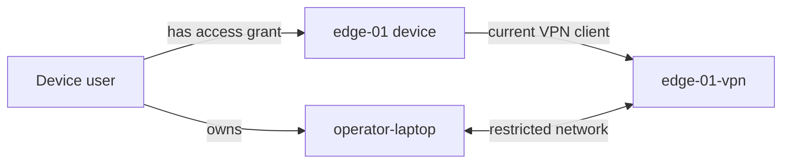

# Client registration, certificates, and restricted network user guide

This guide explains the Rivet web interface. It assumes two users already
exist and can sign in: a **system administrator** (`sysadmin`) and a
**device user** (`device_user`). User creation and deployment are covered
elsewhere.

The example connects the device user's laptop to one edge device. The
administrator prepares the clients, certificates, device record, and network
access. The device user downloads their laptop credentials and connects.

Device users can go straight to
[download credentials and connect][device-user-setup].
Administrators should complete the setup steps first.

- [1. Choose the correct account](#1-choose-the-correct-account)
- [2. Understand the records you will create](#2-understand-the-records-you-will-create)
- [3. Administrator: confirm the server is ready](#3-administrator-confirm-the-server-is-ready)
- [4. Administrator: register the two VPN clients](#4-administrator-register-the-two-vpn-clients)
- [5. Administrator: assign fixed VPN addresses](#5-administrator-assign-fixed-vpn-addresses)
- [6. Administrator: assign ownership and register the device](#6-administrator-assign-ownership-and-register-the-device)
- [7. Administrator: create the restricted network](#7-administrator-create-the-restricted-network)
- [8. Administrator: install credentials on the edge device](#8-administrator-install-credentials-on-the-edge-device)
- [9. Device user: download credentials and connect](#9-device-user-download-credentials-and-connect)
- [10. Manage certificate expiry and replacement](#10-manage-certificate-expiry-and-replacement)
- [11. Remove access or retire a client](#11-remove-access-or-retire-a-client)
- [12. Troubleshooting](#12-troubleshooting)

## 1. Choose the correct account

Open the control panel URL supplied by your organization and sign in with
Microsoft Entra ID.

| Account | Responsibilities |
| --- | --- |
| System administrator | Register equipment; manage certificates and access. |
| Device user | Download owned credentials; connect to authorized devices. |

The administrator has **VPN clients**, **Devices**, **Users**, **Server**,
and **Networks** in the navigation. The device user uses **Portal**,
**My VPN clients**, and **My devices**.

Use separate browser profiles when checking both accounts. An existing user
record alone does not grant administrator permissions; those come from the
account's configured sign-in role.

## 2. Understand the records you will create

| Record | Meaning |
| --- | --- |
| VPN client | One VPN identity with its own certificate and private key. |
| Virtual address | The fixed VPN address assigned to a client. |
| Device | A stable equipment record linked to its current VPN client. |
| Client ownership | Lets a user download that client's credentials. |
| Device access grant | Makes the device available in that user's portal. |
| Restricted network | Applies firewall access between selected VPN clients. |

We will use these names throughout:

| Item | Example name | Purpose |
| --- | --- | --- |
| Laptop VPN client | `operator-laptop` | Used on the device user's laptop. |
| Edge VPN client | `edge-01-vpn` | Installed on the edge device. |
| Device | `edge-01` | The equipment shown in **My devices**. |

Client ownership, device access, and network access are separate actions.
Granting a device does not create a firewall rule. Assigning a laptop client
does not grant access to any device.

## 3. Administrator: confirm the server is ready

Open **Server** and check that the OpenVPN service is running and assignable
virtual addresses are available.

If the server has not been initialized, enter the VPN hostname or IP address
provided by the deployment operator and choose **Initialize server**. Use the
endpoint that VPN applications will connect to; the control panel's web
address may be different.

For an initialized server, use **Server > Shared client profile**, enter that
VPN endpoint, and choose **Generate shared profile** if the profile is missing
or transport settings have changed.

Before enabling restricted networks, have the deployment operator confirm:

- OpenVPN, Easy-RSA, and certificate storage are ready for client creation.
- Clients use fixed addresses and exclusive client configuration files.
- OpenVPN's `client-to-client` option is disabled so the host can filter
  traffic between clients.
- The VPN interface is `tun0`, as required by the current restricted network
  rules, and IP forwarding is enabled.
- The forwarding chain ends with a drop rule for traffic arriving on `tun0`.
  Earlier broad allow rules must not bypass this restriction. rivet inserts
  its allow rules immediately before the chain's final rule.
- OpenVPN checks an up-to-date certificate revocation list that its running
  service can read.

These are host configuration prerequisites; the web interface does not set
them up. See the [production deployment runbook](deployment.md#production-ingress-and-verification)
for deployment and shared profile configuration.

## 4. Administrator: register the two VPN clients

1. Open **VPN clients**.
2. Under **Create VPN client**, enter `operator-laptop` in **Client name**.
3. Choose **Create client** and wait for success.
4. Repeat for `edge-01-vpn`.
5. Open each client and review its certificate status and expiry date.

Use unique names containing only letters, digits, hyphens, or underscores,
with at most 255 characters. Creating a VPN client also creates its
certificate and private key. Creating a Device later does not issue another
certificate.

Give every laptop or VPN-connected device its own client identity. The
administrator account does not need a VPN client just to manage the panel.

### If certificates already exist

Use **VPN clients > Import clients** to import valid clients already present
in the server's Easy-RSA certificate store. This scans the existing store; it
does not upload a certificate from your computer.

Leave **Create matching edge devices** unchecked if the store includes
laptop clients or you want to register devices individually. Selecting it
attempts to create a same-name Device for every imported client.

Review the added, updated, skipped, and device conflict counts. Imports do
not reassign conflicting device links. Resolve those links in **Devices**
before continuing. Imports also do not assign clients to users or grant
device access.

## 5. Administrator: assign fixed VPN addresses

For each of `operator-laptop` and `edge-01-vpn`:

1. Open the client from **VPN clients**.
2. In **Virtual address**, select an available address.
3. Choose **Assign address**.
4. Confirm that **Current address** shows the selected value.

Record both addresses. For example, an installation using `10.8.0.0/24`
might assign `10.8.0.10` to the laptop and `10.8.0.20` to the edge device.
Select addresses actually offered by your server.

Both clients need an address before a restricted network can be created.
Revoked clients cannot receive an address. Reconnect a client after changing
its address so its VPN connection uses the new assignment.

Before unassigning or changing an address later, close every active
restricted network involving that client. Those networks retain the addresses
used when they were created and must be recreated after the change.

## 6. Administrator: assign ownership and register the device

### Assign the laptop to the existing device user

1. Open **Users** and select the existing device user.
2. Open the **VPN clients** tab.
3. Under **Assign VPN client**, select `operator-laptop`.
4. Choose **Assign client** and confirm it appears in the assigned list.

A user can own several laptop clients, but each client can have only one
owner. If the client is missing from the selector, check whether it already
belongs to another user.

Keep the edge device's credentials with the person provisioning that device.
Granting access to the device does not require assigning `edge-01-vpn` to the
device user. Such ownership would let them download the device's private key.

### Register the edge device

1. Open **Devices > Create device**.
2. Enter `edge-01` in **Device name**.
3. Select `edge-01-vpn` as **Current VPN client**.
4. Choose **Create device**.
5. Open the device and confirm its current VPN client and provisioning state.

A Device can be registered with **No VPN client** and linked later through
**Edit device**. Each VPN client can be linked to only one Device.
**Provisioned** indicates that an active client is linked; it does not prove
the equipment is online.

### Grant the user access to the device

1. Return to **Users** and open the existing device user.
2. Open the **Device access** tab.
3. Select `edge-01` under **Grant device access**.
4. Choose **Grant access**.
5. Confirm the device appears as **Authorized**.

The **Not enforced** label means this grant does not itself configure
OpenVPN or the firewall. It remains that way even after you create a
restricted network; it is not a live connectivity indicator.

## 7. Administrator: create the restricted network

1. Open **Networks > Create network**.
2. Select `operator-laptop` as **Source VPN client**.
3. Select `edge-01-vpn` as **Destination VPN client**.
4. Leave **Private destinations** empty for a device connected directly to
   the VPN.
5. Choose **Create restricted network**, review the confirmation, and confirm.
6. Review the resulting record and note its network ID.

The record should have a start time and no end time. It remains open until
an administrator closes it; there is no automatic expiry setting. After a
host restart or firewall reload, have the deployment operator verify and
restore the intended rules. The record is not a live check of host rules.

This permits traffic in both directions between the selected VPN addresses,
across all ports and protocols. The form does not offer per-port rules. Ask
the deployment operator to configure any additional service restrictions.
Other forwarded VPN traffic remains blocked only when the host's default
restrictions from step 3 are in place. Access to services on the VPN server
itself requires separate host policy.

Repeat for each additional laptop client and destination that should be
reachable. Access granted to a user does not automatically cover all of that
user's VPN clients. Check existing records before creating another network
for the same pair.

### Optional: reach equipment behind a gateway

Use this workflow only when a gateway already connects a private LAN to the
VPN. For example, `site-gateway-vpn` might serve `192.168.50.0/24`.

The gateway's **Client network** must already show the intended private
subnet. Its fixed address, OpenVPN gateway routing, LAN forwarding, and return
path to the VPN subnet must be configured by the deployment operator. The
current **Create client** form has no private subnet field, so complete
gateway provisioning requires operator setup outside this browser workflow.
Importing certificates alone does not populate the gateway subnet.

Once the gateway is ready:

1. Open **Server > Manage routes** and check for the private subnet route.
   If it is missing, add `192.168.50.0/24` using **Add route** and confirm.
2. Open **Networks > Create network**.
3. Select `operator-laptop` as the source and `site-gateway-vpn` as the
   destination.
4. Enter only the permitted private host addresses in **Private destinations**,
   separated by commas, for example `192.168.50.10,192.168.50.11`.
5. Create the network, then reconnect the laptop VPN to receive its routes.

Use individual RFC 1918 private IPv4 host addresses here. Although the form
accepts subnets, the current route generator builds host routes; subnet-wide
destinations require operator review. This network also permits access to the
gateway's own VPN address.

Closing a network with private destinations currently removes all pushed
routes from that source client's configuration, including routes associated
with other networks. Coordinate changes if the laptop has multiple gateway
networks, restore the required remaining configuration, and reconnect it.

## 8. Administrator: install credentials on the edge device

1. Open **VPN clients > edge-01-vpn**.
2. Under **Certificate operations**, choose **Package** and wait for success.
3. Choose **Download** to save `edge-01-vpn.zip`.
4. Open **My VPN clients** and use **Connection setup > Download shared
   profile** to save `rivet-client.ovpn`. This shared download is available
   even if the administrator has no owned laptop client.
5. Give these files to the person provisioning the edge device through your
   organization's approved secure transfer method.

Extract the ZIP and configure the device's OpenVPN application using the
shared profile and these separate credential files:

| OpenVPN setting | File |
| --- | --- |
| Profile/configuration | `rivet-client.ovpn` |
| CA certificate | `ca.crt` |
| Client certificate | `edge-01-vpn.crt` |
| Private key | `edge-01-vpn.key` |

Use the device vendor's configuration screen or provisioning procedure, then
connect the device to the VPN. The shared profile contains connection
settings and does not contain the client's certificate or private key.

The ZIP contains a private key without a password. Keep it and the extracted
key in a private location; exclude them from shared folders and support
attachments. If Azure certificate storage is selected, the same download
buttons apply; users do not need Azure storage credentials. If archive cleanup
fails after a VPN client is deleted, an administrator must remove the orphaned
archive from the selected store.

## 9. Device user: download credentials and connect

Sign in with the existing **device user** account.

1. Open **My VPN clients** and find `operator-laptop` with **Active** status.
2. Choose its **Download** button. The portal packages the credentials and
   downloads `operator-laptop.zip` in one action.
3. In **Connection setup**, choose **Download shared profile** to download
   `rivet-client.ovpn`.
4. Extract the ZIP into a private folder and put the shared profile beside
   the extracted files.
5. Open your organization's OpenVPN application and import the shared profile.
6. Configure the corresponding credential fields as shown below, then connect.

| OpenVPN setting | File |
| --- | --- |
| Profile/configuration | `rivet-client.ovpn` |
| CA certificate | `ca.crt` |
| Client certificate | `operator-laptop.crt` |
| Private key | `operator-laptop.key` |

The names of these fields vary by OpenVPN application. If your application
cannot select separate credential files, ask the administrator for its
supported import procedure. The ZIP is a credential archive, not a complete
OpenVPN profile.

Open **My devices** and select `edge-01`. **Authorized** confirms the device
grant. Use the device address and application supplied by your administrator
to reach it, such as its maintenance application at its fixed VPN address.
The portal does not open a remote device session for you.

The administrator should verify an allowed device connection succeeds and
an unapproved destination remains blocked. A VPN connection alone does not
confirm that the restricted network is working.

## 10. Manage certificate expiry and replacement

The administrator can review **Expires** on each page under **VPN clients**.
**Active** means the client has not been marked revoked; check the expiry
date separately. Device users can download active owned credentials but
cannot issue, renew, or revoke certificates.

### Renewal

**Certificate operations** includes **Renew**, but the current implementation
does not itself issue a new certificate: it invokes Easy-RSA's
`revoke-renewed` operation. A success message alone therefore does not prove
the validity period was extended. Have the deployment operator complete and
verify renewal using the installed Easy-RSA version, or use client
replacement below. Easy-RSA distinguishes these operations in its
[renewal documentation][easyrsa-renewal].

After a verified renewal, check that **Expires** reflects the new certificate.
Use **Package** and **Download** again for an edge device. A device user can
use **My VPN clients > Download** again for their laptop. Replace the
installed credentials, reconnect, and verify access. An old downloaded ZIP
does not update automatically.

### Replace a laptop or device VPN identity

1. Create a client with a new unique name, such as `edge-01-vpn-v2`, and assign
   it an available virtual address.
2. For a laptop, assign the new client to the existing user. For an edge
   device, use **Devices > edge-01 > Edit device** to select the new
   **Current VPN client** and save. The Device and its access grants remain.
3. Package and install the new credentials on the intended equipment.
4. Close the old restricted networks and create the required networks for
   the replacement client.
5. Connect with the replacement and verify the intended access.
6. Revoke the old client and remove it as described below.

Plan the change to allow for a connection interruption. If the old key is
lost or exposed, remove its network access and revoke it immediately instead
of waiting for replacement testing.

## 11. Remove access or retire a client

### Remove one user's access to a device

1. In **Networks**, close all active networks connecting that user's laptop
   clients to the device's VPN client or the relevant gateway destinations.
   Open each record and choose **Close network**, then confirm.
2. In **Users > the device user > Device access**, choose **Revoke** for the
   device and confirm **Revoke access**.
3. Verify the device disappears from **My devices** for that user and that
   the intended network access has stopped.

Revoking the grant alone leaves firewall access in place. Closing a network
sets its end time and retains its history. To allow access again, create a
new restricted network and restore the device grant as needed.

### Revoke and delete a VPN client

1. Close every active restricted network involving the client before its
   address can be reused.
2. Open the client in **VPN clients** and choose **Revoke certificate**.
   Type the exact client name and confirm **Revoke certificate**. Check that
   the status becomes **Revoked**.
3. Have the deployment operator verify that OpenVPN uses the updated
   revocation list and terminate any existing connection when immediate
   disconnection is required. The panel's revoke action does not terminate
   a live VPN session.
4. If the identity is being retired, choose **Delete VPN client**, type its
   exact name, and confirm **Delete VPN client**. This is available only after
   revocation.
5. Remove the retired profile and credentials from the equipment and any
   retained download locations according to your organization's procedure.

Deleting the client releases its address and removes ownership links, local
credential artifacts, and connection records. A linked Device is kept but
becomes unlinked; its device access grants remain. Review those grants if the
equipment is also being retired.

Deleting a Device, unlinking a laptop from a user, or signing out of the panel
does not revoke previously downloaded VPN credentials. Use certificate
revocation when those credentials must stop working.

## 12. Troubleshooting

| What you see | What to do |
| --- | --- |
| Administrator navigation is missing | Check the signed-in account and role. |
| **No VPN clients assigned** | Ask the admin to assign your laptop client. |
| **No devices authorized** | Ask the admin to grant the intended Device. |
| A client is absent from a selector | Check existing owner or Device links. |
| Client creation fails | Check name uniqueness and host certificate setup. |
| No assignable addresses | Ask the admin to review server address capacity. |
| Restricted network creation fails | Assign both addresses; check host rules. |
| Shared profile download fails | Ask the admin to generate the profile. |
| Certificate download fails | Check ownership, revocation, and packaging. |
| Credentials are unavailable | Ask the admin to replace the revoked client. |
| **Authorized**, but device unreachable | Check both VPNs, rules, and routes. |
| **Not enforced** remains visible | This is not a network status check. |
| VPN connects but application fails | Check the service and local firewall. |
| Private LAN is unreachable | Reconnect; check gateway and LAN return routes. |
| **Renew** succeeds but expiry is unchanged | Ask the operator about renewal. |

When requesting help, provide the client or device name, the action, and the
time of failure. Keep private keys, credential archives, and sign-in tokens
out of screenshots and support messages.

[easyrsa-renewal]:
https://github.com/OpenVPN/easy-rsa/blob/master/doc/EasyRSA-Renew-and-Revoke.md

[device-user-setup]: #9-device-user-download-credentials-and-connect
